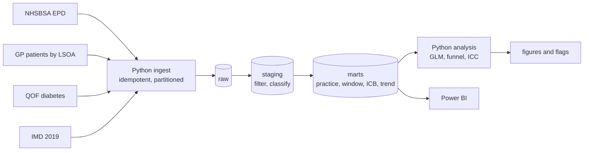

# Diabetes Prescribing and Health Inequalities in England

**Question:** Does the prescribing of newer diabetes drugs (SGLT2 inhibitors and GLP-1 / GIP agonists) vary across
GP practices and Integrated Care Boards (ICBs) in ways that practice deprivation and diabetes prevalence do not explain?

`PostgreSQL` `Python` `statsmodels` `Power BI` `GitHub Actions`

> **Status:** analysis complete on real data (April 2023 to March 2024). The dashboard build and publication checks
> are the remaining steps; see the checklist at the end of this file.

## Headline findings
* Newer diabetes drugs (SGLT2 inhibitors and GLP-1 / GIP agonists) were **25.4%** of non-insulin diabetes prescribing.
  The share was **24.3% in the most deprived fifth of practices and 27.1% in the least deprived**.
* After adjusting for diabetes prevalence, practice size and NHS region, each 10-point rise in practice deprivation was
  associated with **3% lower odds** of a newer-drug item (odds ratio 0.97, 95% CI 0.96 to 0.99). Real, but modest.
* Overall prescribing volume went the other way: **16.9 diabetes items per patient on the register in the most deprived
  fifth versus 14.2 in the least deprived**.
* Practices vary far more than chance explains (overdispersion factor 89), and about **one sixth of the variation sits
  between ICBs** (16%, 95% CI 10% to 22%, after adjustment), which deprivation barely changes.
* The gap between the most and least deprived fifths **widened over the year**, because newer drugs grew faster where
  deprivation was lowest.

## Why this matters
NICE and the NHS encourage SGLT2 inhibitors and GLP-1 agonists for people with type 2 diabetes who
have cardiovascular, kidney or obesity-related risk. If uptake is lower where deprivation is higher, that is a
potential inequality; if it varies widely between ICBs after adjustment, that is unwarranted variation worth examining.
This project measures both, using public data only.

## Data (all free and open)
| Source | Used for |
|---|---|
| NHSBSA English Prescribing Dataset (EPD) with SNOMED code, BNF 6.1, Apr 2023 to Mar 2024 | items and cost by practice, month and drug |
| NHS England Digital: patients registered at GP practices by LSOA | list size and practice deprivation (via patient-weighted LSOA scores) |
| NHS England Digital: QOF 2023-24 diabetes register | diabetes prevalence |
| English Indices of Deprivation 2019 (IMD) | deprivation score per LSOA |

Details, expected file names and the choices to record are in [`docs/DATA_SOURCES.md`](docs/DATA_SOURCES.md).

## Architecture


**PostgreSQL design.** `raw.epd` is list-partitioned by month; each month is reloaded by truncating its partition, so
re-running never duplicates rows. Staging filters to insulins (BNF 060101) and antidiabetic drugs (060102), dropping
hypoglycaemia, diagnostic and monitoring items that share BNF section 6.1. Marts have a fact table at
practice x month x drug class, plus a 12-month practice table, an ICB summary and a class-by-quintile trend.
`staging.dq_summary` records what was excluded rather than dropping rows silently.

## Methods
* **Outcome:** newer-drug share = SGLT2 + GLP-1/GIP items as a share of non-insulin diabetes items, latest 12 months.
  Also items per diabetes-register patient, as an overall volume measure.
* **Deprivation:** patient-weighted mean IMD 2019 score across the LSOAs a practice's patients live in.
  Quintile 1 = most deprived fifth of included practices.
* **Inclusion:** list size at least 1,000; diabetes register at least 20; deprivation and prevalence available.
  Excluded practices are counted and reported, not hidden.
* **Models:** a binomial GLM on newer vs other non-insulin items with ICB-clustered robust standard errors,
  adjusted for prevalence, list size and NHS region; an OLS model on log items per register patient; and a
  random-intercept model giving the share of variance sitting between ICBs before and after adjustment.
* **Funnel plot:** overdispersion-adjusted limits (Spiegelhalter) around the national share, flagging practices
  beyond 99.8% limits. Overdispersion is expected, so unadjusted limits would flag most practices.

## Run it
Needs Python 3.12, Docker Desktop and about 15 GB of free disk space for the intermediate files.

```bash
python -m venv .venv
.venv\Scripts\activate            # Mac/Linux: source .venv/bin/activate
pip install -r requirements.txt
docker compose up -d db           # PostgreSQL 16 on localhost:5433
```

**Try it first on synthetic data** (no downloads, under a minute; results are NOT real):
```bash
python -m src.make_demo_data
python -m src.ingest --source data/demo
python -m src.build_marts
python -m src.checks
pytest -q
```
On Mac/Linux, `make demo` does all of this.

**Run it on the real data.**
1. Put the three reference files in `data/raw/` as described in [`docs/DATA_SOURCES.md`](docs/DATA_SOURCES.md)
   (`gp_lsoa.csv`, `qof_diabetes.csv`, `imd.csv`).
2. Download the prescribing months (streams and keeps diabetes rows only; resumable, several hours in total):
   `python -m src.download_epd`
3. Load, build, check, analyse, export:
```bash
python -m src.ingest --source data/raw
python -m src.build_marts
python -m src.checks            # all 10 checks must pass before you trust the analysis
python -m src.analysis
python -m src.export_for_powerbi
```
4. Build the dashboard from [`powerbi/README.md`](powerbi/README.md).

If something fails, see [`docs/ISSUES_AND_FIXES.md`](docs/ISSUES_AND_FIXES.md), which records the problems met while
building this and how they were solved. Common ones: activate the virtual environment first, and keep Docker Desktop running.

## Results

### Part 1: deprivation and diabetes prevalence (real data, QOF 2023-24)
Run with `make profile`. After excluding practices with fewer than 1,000 registered patients, fewer than 20 people on
the diabetes register, or no QOF record, **6,248 of 6,325 practices** are included. The patient-weighted deprivation
score was available for almost every patient (median practice coverage 99.98%).

| Deprivation quintile | Practices | Crude diabetes prevalence (aged 17+) |
|---|---|---|
| 1 (most deprived) | 1,250 | 9.25% |
| 2 | 1,249 | 8.22% |
| 3 | 1,250 | 7.63% |
| 4 | 1,249 | 7.23% |
| 5 (least deprived) | 1,250 | 6.42% |

Practice-level rank correlation between deprivation and prevalence is 0.51 (Spearman). These are **crude** rates:
the data have no age breakdown, and deprived areas are not simply older or younger, so the gradient mixes real
differences with age structure. Treat it as the context for the prescribing analysis, not as a standalone finding.


### Part 2: newer-drug prescribing (real data, April 2023 to March 2024)
**Sample.** 6,248 GP practices in 42 ICBs, which account for 99.5% of diabetes prescribing in the data. Organisations
with no GP registration record (1,590, mostly non-GP prescribers and closed practices) carry 0.4% of items; 54 practices
had no QOF diabetes register, 17 had under 1,000 patients and 1 had fewer than 20 people with diabetes.

**By deprivation quintile** (1 = most deprived; `outputs/results/by_deprivation_quintile.csv`):

| Quintile | Practices | Newer-drug share of non-insulin items | Diabetes items per register patient |
|---|---|---|---|
| 1 (most deprived) | 1,250 | 24.3% | 16.9 |
| 2 | 1,250 | 24.5% | 16.4 |
| 3 | 1,250 | 25.7% | 15.0 |
| 4 | 1,249 | 26.2% | 14.7 |
| 5 (least deprived) | 1,249 | 27.1% | 14.2 |


The smoothed trend falls from about 27% in the least deprived practices to about 24% around an IMD score of 30, then
flattens. So the average association in the models below is driven mainly by the less-to-moderately deprived end, and the
models, which assume a constant effect, summarise it with one number.

**Models** (`outputs/results/results.json`; standard errors clustered by ICB):

| Question | Result |
|---|---|
| Odds of a newer-drug item per 10 IMD points, adjusted | OR 0.97 (95% CI 0.96 to 0.99, p < 0.001) |
| Diabetes items per register patient per 10 IMD points, adjusted | +4.3% (95% CI 2.0% to 6.6%) |
| Share of practice-level variance in newer-drug share lying between ICBs | 17.5% (95% CI 11.6% to 23.5%) unadjusted; 16.1% (10.0% to 21.8%) after adjusting for deprivation, prevalence and list size |

Across the roughly 32-point gap in mean IMD score between the most and least deprived fifths, the odds ratio compounds to
about 0.91 (my arithmetic from the per-10-point estimate, not a separate model). The volume result means practices in
deprived areas issued more diabetes items per patient with diabetes, which could reflect more complex disease or more
drugs per person, and is not evidence of better or worse care.

**Practice variation.** A funnel plot with overdispersion-adjusted limits (factor 89.0) flags **137 practices (2.2%)**
outside the 99.8% limits: 83 above and 54 below the national share. Practices are unusual in clusters rather than at random:
high outliers are concentrated in Mid and South Essex (9), Hampshire and Isle of Wight (8), Kent and Medway (6) and
Lancashire and South Cumbria (6); low outliers in West Yorkshire (14), North East London (14), North East and North Cumbria (7)
and South East London (5). That points to ICB-level or local factors such as formularies, guidance or population mix, but
these data cannot say which. The full list is in `outputs/results/funnel_flags.csv`.


**Over time.** The newer-drug share rose in every quintile, roughly from 23.0% to 25.8% in the most deprived fifth and from
25.3% to 29.2% in the least deprived (values read from the chart; exact monthly figures are in
`data/exports/mart_class_trend.csv`). The gap therefore widened from about 2.3 to about 3.4 percentage points.


*Dashboard link and screenshots: to add.*

## Limitations (read before drawing conclusions)
* **Ecological and observational.** Practice-level patterns do not describe individual patients, and association is not cause.
* **Prescribing is not need.** Eligibility for newer drugs depends on kidney function, cardiovascular disease, BMI and
  other factors that are not in these data. Differences may reflect case mix.
* **Supply and policy effects.** GLP-1 shortages and changing national guidance during 2023-24 affect prescribing
  independently of practice behaviour. The window is one year, so these results describe that year only.
* **No age adjustment.** The data have no age breakdown, so prevalence is crude and deprivation may partly stand in for age structure.
* **Newer drugs are not always better drugs for every patient.** The share is a measure of uptake, not of appropriateness.
* **Funnel outliers are unusual, not "bad".** Coding, shared-care arrangements and specialist clinics can explain them.
* **Reuse.** Include the NHSBSA copyright statement and contact NHSBSA before publishing figures (see `docs/DATA_SOURCES.md`).
* **Denominators.** List size comes from a single LSOA extract and QOF uses a 17+ denominator; both are approximations.
* **Practice changes.** Mergers and closures mean some practices lack denominators and are excluded.
* **Geography.** IMD 2019 covers England only and uses 2011 LSOAs.

## Before publishing
- [ ] Reply received from NHSBSA (see `docs/DATA_SOURCES.md`), and attribution line updated with the year they give
- [ ] Practice names in `funnel_flags.csv` are public data, but decide whether you want a named list of practices in a public repo
- [ ] Dashboard built, screenshots added, link added above
- [ ] `git status` shows no files from `data/raw` or `data/exports` staged

## Issues and fixes
The problems found while building this project (a retired dataset, mismatched area codes, a classifier bug caught by a data check, an unreliable model, failed downloads) are written up in [`docs/ISSUES_AND_FIXES.md`](docs/ISSUES_AND_FIXES.md).

## Repo layout
```
sql/        01_schema, 02_staging, 03_marts
src/        ingest, build_marts, checks, profile_reference, analysis, stats, export_for_powerbi, download_epd, make_demo_data
tests/      unit tests for the funnel statistics
powerbi/    dashboard build guide with DAX
docs/       data sources, and issues found and how they were fixed
.github/    CI: runs tests and the full demo pipeline against Postgres
```

## Author
Emmanuel Dwamena, MSc Data Analytics (Distinction), BSc Biomedical Science. [LinkedIn](https://linkedin.com/in/emmanuel-dwamena)
