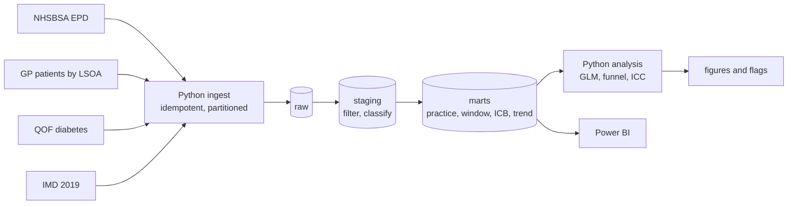
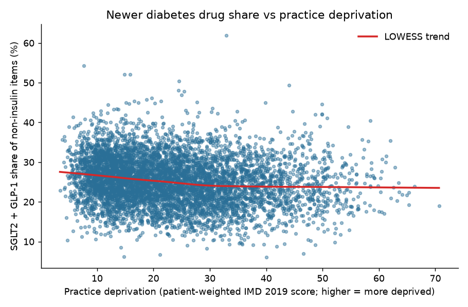

# Diabetes Prescribing and Health Inequalities in England

**Question:** Does the prescribing of newer diabetes drugs (SGLT2 inhibitors and GLP-1 / GIP agonists) vary across
GP practices and Integrated Care Boards (ICBs) in ways that practice deprivation and diabetes prevalence do not explain?

**In plain English:** in 2023-24, GP practices in more deprived areas prescribed a slightly smaller share of the newer diabetes drugs
(24.3% against 27.1% in the least deprived practices), although they issued more diabetes items per patient overall. Differences between
areas (ICB averages from 19.6% to 30.3%) and between individual practices were much wider than that deprivation gap, and the gap widened
over the year. These are practice-level patterns from public data. They do not show that any patient received worse care.

`PostgreSQL` `Python` `statsmodels` `Power BI` `GitHub Actions`

> **Status:** analysis complete on real data (April 2023 to March 2024).

## Headline findings
* Newer diabetes drugs (SGLT2 inhibitors and GLP-1 / GIP agonists) were **25.4%** of non-insulin diabetes prescribing.
  The share was **24.3% in the most deprived fifth of practices and 27.1% in the least deprived**.
* After adjusting for diabetes prevalence, practice size and NHS region, each 10-point rise in practice deprivation was
  associated with **3% lower odds** of a newer-drug item (odds ratio 0.97, 95% CI 0.96 to 0.99). Real, but modest.
* Overall prescribing volume went the other way: **16.9 diabetes items per patient on the register in the most deprived
  fifth versus 14.2 in the least deprived**.
* Practices vary far more than chance explains (overdispersion factor 89), and about **one sixth of the variation sits
  between ICBs** (16%, 95% CI 10% to 22%, after adjustment), which deprivation barely changes.
* ICB averages range from **19.6% to 30.3%**, a far wider spread than the 2.8-point gap between deprivation fifths (unadjusted).
* The gap between the most and least deprived fifths **widened over the year** (2.3 to 3.4 points), because newer drugs grew faster where
  deprivation was lowest.


*The Overview page of the Power BI dashboard. All five pages are shown in the [Dashboard](#dashboard) section.*

## Key terms
| Term | Meaning here |
|---|---|
| **Newer drugs** | SGLT2 inhibitors and GLP-1 / GIP agonists, two classes of diabetes medicine recommended for people with cardiovascular, kidney or obesity-related risk |
| **Newer-drug share** | Newer-drug items as a percentage of all non-insulin diabetes items a practice prescribed |
| **ICB** | Integrated Care Board: the NHS organisation that plans and funds local services. There are 42 in England |
| **IMD** | Index of Multiple Deprivation 2019, an official measure of how deprived a small area is. A higher score means more deprived. A practice's score is the average across its patients' home areas |
| **LSOA** | Lower layer Super Output Area: a small census area of roughly 1,500 people, the unit at which IMD is published |
| **Deprivation fifth (quintile)** | Practices ranked by deprivation and split into five equal groups. Q1 is the most deprived and Q5 the least |
| **Odds ratio** | How much the odds of an item being a newer drug change for a given change in deprivation. 0.97 per 10 IMD points means 3% lower odds |
| **Funnel plot** | A chart comparing each practice with the national share, allowing for how much it prescribes. Practices beyond the limits are unusual, which is not the same as poorer care |
| **ICC** | Intraclass correlation: the share of variation that lies between ICBs and not between practices within the same ICB |

## Why this matters
NICE and the NHS encourage SGLT2 inhibitors and GLP-1 agonists for people with type 2 diabetes who
have cardiovascular, kidney or obesity-related risk. If uptake is lower where deprivation is higher, that is a
potential inequality; if it varies widely between ICBs after adjustment, that is unwarranted variation worth examining.
This project measures both, using public data only.

## Data (all free and open)
| Source | Used for |
|---|---|
| NHSBSA English Prescribing Dataset (EPD) with SNOMED code, BNF 6.1, Apr 2023 to Mar 2024 | items and cost by practice, month and drug |
| NHS England Digital: patients registered at GP practices by LSOA | list size and practice deprivation (via patient-weighted LSOA scores) |
| NHS England Digital: QOF 2023-24 diabetes register | diabetes prevalence |
| English Indices of Deprivation 2019 (IMD) | deprivation score per LSOA |

Details, expected file names and the reasons for the chosen study window are in [`docs/DATA_SOURCES.md`](docs/DATA_SOURCES.md).

## Architecture


**PostgreSQL design.** `raw.epd` is list-partitioned by month; each month is reloaded by truncating its partition, so
re-running never duplicates rows. Staging filters to insulins (BNF 060101) and antidiabetic drugs (060102), dropping
hypoglycaemia, diagnostic and monitoring items that share BNF section 6.1. Marts have a fact table at
practice x month x drug class, plus a 12-month practice table, an ICB summary and a class-by-quintile trend.
`staging.dq_summary` records what was excluded rather than dropping rows silently.

## Methods
* **Outcome:** newer-drug share = SGLT2 + GLP-1/GIP items as a share of non-insulin diabetes items, latest 12 months.
  Also items per diabetes-register patient, as an overall volume measure.
* **Deprivation:** patient-weighted mean IMD 2019 score across the LSOAs a practice's patients live in.
  Quintile 1 = most deprived fifth of included practices.
* **Inclusion:** list size at least 1,000; diabetes register at least 20; deprivation and prevalence available.
  Excluded practices are counted and reported, not hidden.
* **Models:** a binomial GLM on newer vs other non-insulin items with ICB-clustered robust standard errors,
  adjusted for prevalence, list size and NHS region; an OLS model on log items per register patient; and a one-way ANOVA intraclass correlation, with a bootstrap that resamples ICBs for the 95% interval, giving the share of variance
  sitting between ICBs before and after adjustment (a mixed model was tried first but did not converge; see `docs/ISSUES_AND_FIXES.md`).
* **Funnel plot:** overdispersion-adjusted limits (Spiegelhalter) around the national share, flagging practices
  beyond 99.8% limits. Overdispersion is expected, so unadjusted limits would flag most practices.

## Run it
Works on Windows, macOS and Linux. It needs Python 3.12, Docker (Docker Desktop on Windows or macOS, Docker Engine on Linux) and about 15 GB of free disk space for the
intermediate files. `make` is optional: Windows does not include it, and every `make` target below has a plain `python -m ...` equivalent that behaves the same on every system.

**1. Set up** (run from the repository folder)

| | Create and activate the virtual environment |
|---|---|
| Windows, PowerShell | `python -m venv .venv` then `.venv\Scripts\Activate.ps1` (if scripts are blocked, run `Set-ExecutionPolicy -Scope Process -ExecutionPolicy Bypass` first) |
| Windows, Command Prompt | `python -m venv .venv` then `.venv\Scripts\activate.bat` |
| macOS / Linux | `python3 -m venv .venv` then `source .venv/bin/activate` |

On Windows, use `py -3.12 -m venv .venv` if `python` is not found. Then, on every system:
```bash
pip install -r requirements.txt
docker compose up -d db           # PostgreSQL 16 on localhost:5433 (keep Docker running)
```

**2. Try it first on synthetic data** (no downloads, under a minute; results are NOT real). These commands are the same on every system:
```bash
python -m src.make_demo_data
python -m src.ingest --source data/demo
python -m src.build_marts
python -m src.checks
pytest -q
```
To also run the analysis and export on the demo data, send the output to separate folders so real results are never overwritten:

| | Demo analysis and export |
|---|---|
| macOS / Linux | `make demo` does all of step 2 including this, or: `OUTPUT_DIR=outputs/demo EXPORT_DIR=data/demo/exports python -m src.analysis` then the same prefix before `python -m src.export_for_powerbi` |
| Windows, PowerShell | `$env:OUTPUT_DIR="outputs/demo"; $env:EXPORT_DIR="data/demo/exports"`, then `python -m src.analysis` and `python -m src.export_for_powerbi`, then `Remove-Item Env:OUTPUT_DIR, Env:EXPORT_DIR` |
| Windows, Command Prompt | `set OUTPUT_DIR=outputs/demo` and `set EXPORT_DIR=data/demo/exports`, then `python -m src.analysis` and `python -m src.export_for_powerbi`, then `set OUTPUT_DIR=` and `set EXPORT_DIR=` |

> **Warning:** the demo loads synthetic data into the *same* PostgreSQL database as the real data and replaces the tables. Run the demo before loading
> real data, or point it at a separate database with `DATABASE_URL`, and re-run the real pipeline afterwards.

**3. Run it on the real data.** The commands below are the same on every system.
1. Put the three reference files in `data/raw/` as described in [`docs/DATA_SOURCES.md`](docs/DATA_SOURCES.md)
   (`gp_lsoa.csv`, `qof_diabetes.csv`, `imd.csv`).
2. Download the prescribing months (streams and keeps diabetes rows only; resumable, several hours in total):
   `python -m src.download_epd`
3. Load, build, check, analyse, export:
```bash
python -m src.ingest --source data/raw
python -m src.build_marts
python -m src.checks            # all 10 checks must pass before you trust the analysis
python -m src.analysis
python -m src.export_for_powerbi
python -m src.make_dashboard_files   # small clean CSVs for Power BI
```
4. Build the dashboard from [`powerbi/README.md`](powerbi/README.md).

If something fails, see [`docs/ISSUES_AND_FIXES.md`](docs/ISSUES_AND_FIXES.md), which records the problems met while
building this and how they were solved. Common ones: activate the virtual environment first, and keep Docker running.

## Results

### Part 1: deprivation and diabetes prevalence (real data, QOF 2023-24)
Run with `make profile`, or on any system `python -m src.ingest --source data/raw --reference-only` followed by `python -m src.profile_reference`. After excluding practices with fewer than 1,000 registered patients, fewer than 20 people on
the diabetes register, or no QOF record, **6,248 of 6,325 practices** are included. The patient-weighted deprivation
score was available for almost every patient (median practice coverage 99.98%).

| Deprivation quintile | Practices | Crude diabetes prevalence (aged 17+) |
|---|---|---|
| 1 (most deprived) | 1,250 | 9.25% |
| 2 | 1,249 | 8.22% |
| 3 | 1,250 | 7.63% |
| 4 | 1,249 | 7.23% |
| 5 (least deprived) | 1,250 | 6.42% |

Practice-level rank correlation between deprivation and prevalence is 0.51 (Spearman). These are **crude** rates:
the data have no age breakdown, and deprived areas are not simply older or younger, so the gradient mixes real
differences with age structure. Treat it as the context for the prescribing analysis, not as a standalone finding.


### Part 2: newer-drug prescribing (real data, April 2023 to March 2024)
**Sample.** 6,248 GP practices in 42 ICBs, which account for 99.5% of diabetes prescribing in the data. Organisations
with no GP registration record (1,590, mostly non-GP prescribers and closed practices) carry 0.4% of items; 54 practices
had no QOF diabetes register, 17 had under 1,000 patients and 1 had fewer than 20 people with diabetes.

**By deprivation quintile** (1 = most deprived; [`outputs/results/by_deprivation_quintile.csv`](outputs/results/by_deprivation_quintile.csv)):

| Quintile | Practices | Newer-drug share of non-insulin items | Diabetes items per register patient |
|---|---|---|---|
| 1 (most deprived) | 1,250 | 24.3% | 16.9 |
| 2 | 1,250 | 24.5% | 16.3 |
| 3 | 1,250 | 25.7% | 15.0 |
| 4 | 1,249 | 26.1% | 14.7 |
| 5 (least deprived) | 1,249 | 27.1% | 14.2 |



The smoothed trend falls from about 27% in the least deprived practices to about 24% around an IMD score of 30, then
flattens. So the average association in the models below is driven mainly by the less-to-moderately deprived end, and the
models, which assume a constant effect, summarise it with one number.

**Models** ([`outputs/results/results.json`](outputs/results/results.json); standard errors clustered by ICB):

| Question | Result |
|---|---|
| Odds of a newer-drug item per 10 IMD points, adjusted | OR 0.97 (95% CI 0.96 to 0.99, p < 0.001) |
| Diabetes items per register patient per 10 IMD points, adjusted | +4.3% (95% CI 2.0% to 6.6%) |
| Share of practice-level variance in newer-drug share lying between ICBs | 17.5% (95% CI 11.6% to 23.5%) unadjusted; 16.1% (10.0% to 21.8%) after adjusting for deprivation, prevalence and list size |

Across the roughly 32-point gap in mean IMD score between the most and least deprived fifths, the odds ratio compounds to
about 0.91 (my arithmetic from the per-10-point estimate, not a separate model). The volume result means practices in
deprived areas issued more diabetes items per patient with diabetes, which could reflect more complex disease or more
drugs per person, and is not evidence of better or worse care.

**Practice variation.** A funnel plot with overdispersion-adjusted limits (factor 89.0) flags **137 practices (2.2%)**
outside the 99.8% limits: 83 above and 54 below the national share. Practices are unusual in clusters rather than at random:
high outliers are concentrated in Mid and South Essex (9), Hampshire and Isle of Wight (8), Kent and Medway (6) and
Lancashire and South Cumbria (6); low outliers in West Yorkshire (14), North East London (14), North East and North Cumbria (7)
and South East London (5). That points to ICB-level or local factors such as formularies, guidance or population mix, but
these data cannot say which. The full list is in [`outputs/results/funnel_flags.csv`](outputs/results/funnel_flags.csv).


**Over time.** The newer-drug share rose in every quintile: from 23.0% to 25.8% in the most deprived fifth and from
25.3% to 29.2% in the least deprived, so the gap widened from 2.3 to 3.4 percentage points.

**Geography.** ICB averages range from 19.6% (South East London) to 30.3% (Hampshire and Isle of Wight), a spread of
10.7 points. By NHS region, London is lowest (22.6%) and the South East highest (28.2%). These are unadjusted descriptions;
they are not the adjusted estimates above, and the data cannot say why ICBs differ.


## Dashboard
A five-page Power BI report (`powerbi/`, build notes with DAX in [`powerbi/README.md`](powerbi/README.md)) lets readers explore the results by region and ICB.
Screenshots of each page are below. Report file: [`powerbi/diabetes_prescribing_dashboard.pbix`](powerbi/diabetes_prescribing_dashboard.pbix). Open it in Power BI Desktop, then use Home > Transform data > Data source settings > Change Source to point the four data sources at your own copies of `dashboard_*.csv` (written to `data/exports/` by `python -m src.make_dashboard_files`).

| | |
|---|---|
|  |  |
|  |  |
|  | |

## What this means for decision-makers
Intended readers: ICB medicines-optimisation and health-inequalities teams, NHS England regional teams and primary care networks.

* **The scale is material, not trivial.** If the most deprived fifth of practices had the newer-drug share of the least deprived fifth, they
  would have issued about **308,000 more newer-drug items** in the year (11.5% more than they did, 2.3% of the national total). If the 17 ICBs
  below the England share had matched it, the difference would be about **581,000 items** (4.3% of the national total). These are
  *illustrations of scale*, not targets: whether higher use would be clinically appropriate cannot be judged from these data.
* **Geography is a large source of difference.** The ICB scenario (about 581,000 items) is roughly twice the size of the deprivation scenario
  (about 308,000), but the two are not like-for-like: one lifts 17 ICBs to the England average, the other lifts one fifth of practices to the
  level of another fifth, and the ICB figures are unadjusted, so they partly reflect differences in deprivation and population mix (London ICBs are
  both highly deprived and low). Three London
  ICBs (North East London, South East London, South West London) account for about 39% of the ICB gap, followed by North East and North Cumbria
  and West Yorkshire.
* **Variation is not confined to a few hotspots.** Six ICBs hold 47% of the 137 outlier practices, but 34 of 42 ICBs have at least one. About 84%
  of practice-level variation lies *within* ICBs, so an ICB-wide message alone would not reach most of it. Practice-level peer comparison is the
  natural tool.
* **The gap is growing.** The gap between the least and most deprived fifths widened from 2.3 to 3.4 percentage points in twelve months,
  because uptake rose faster where deprivation was lowest. Monitoring it monthly would show whether it narrows.
* **Higher volume per patient in deprived areas** (16.9 versus 14.2 items per patient on the register) could reflect more complex disease,
  more drugs per person, or differences in how patients are coded or reviewed. These data cannot say which. It is worth understanding before reading
  anything into the newer-drug gap.

**Suggested uses.** Use the funnel plot to prioritise which practices or ICBs to look at first, never to judge them. Before any review, add
clinical eligibility information (kidney function, cardiovascular disease, BMI) that is not in these data. For the ICB clusters, check local
formularies, guidance, shared-care pathways with specialist clinics, and supply problems in 2023-24.

## Further work
* **Adjust for clinical need.** The QOF files include practice-level registers for conditions such as chronic kidney disease, coronary heart
  disease, heart failure and obesity. Adding them to the models would test how much of the pattern reflects eligibility. This is the most
  valuable next step.
* **Add age structure.** NHS England publishes registered patients by age; age-standardising prevalence would improve the context analysis.
* **Sensitivity checks.** Repeat the analysis with SGLT2 inhibitors alone, with different practice-size thresholds, and with a longer period.
* **Costs.** NHSBSA changed its actual-cost methodology in April 2024, so a cost analysis needs a later window and care with comparisons.
* **Ethnicity** is not available at practice level in these sources, which limits what can be said about inequalities beyond deprivation.

## Limitations
* **Ecological and observational.** Practice-level patterns do not describe individual patients, and association is not cause.
* **Prescribing is not need.** Eligibility for newer drugs depends on kidney function, cardiovascular disease, BMI and
  other factors that are not in these data. Differences may reflect case mix.
* **Supply and policy effects.** GLP-1 shortages and changing national guidance during 2023-24 affect prescribing
  independently of practice behaviour. The window is one year, so these results describe that year only.
* **No age adjustment.** The data have no age breakdown, so prevalence is crude and deprivation may partly stand in for age structure.
* **Off-label and weight-loss use.** During the 2023-24 GLP-1 shortage some diabetes-licensed GLP-1 and GIP products were prescribed off-label for
  weight loss. The data cannot separate these items from use in diabetes, so the GLP-1/GIP share may be overstated in some practices.
* **Newer drugs are not always better drugs for every patient.** The share is a measure of uptake, not of appropriateness.
* **Funnel outliers are unusual, not "bad".** Coding, shared-care arrangements and specialist clinics can explain them.
* **Scope of the prescribing data.** The EPD excludes medicines supplied under Patient Group Directions and dental prescribing, and
  includes hospital prescribing only when issued under cost-centre codes. NHSBSA also notes that BNF and SNOMED codes for a product can
  change over time, and tags the dataset as experimental. Items, not costs, are analysed, so the April 2024 change to actual-cost
  methodology does not affect these results.
* **Denominators.** List size comes from a single LSOA extract and QOF uses a 17+ denominator; both are approximations.
* **Practice changes.** Mergers and closures mean some practices lack denominators and are excluded.
* **Geography.** IMD 2019 covers England only and uses 2011 LSOAs.

## Attribution and licence
**Code:** MIT Licence (see [`LICENSE`](LICENSE)). The data, and results derived from them, carry the attributions below.

**NHSBSA Copyright 2025.**

Contains information from NHS England, licenced under the current version of the Open Government Licence.

Contains public sector information licensed under the
[Open Government Licence v3.0](https://www.nationalarchives.gov.uk/doc/open-government-licence/version/3/).

This is an independent project. It is not endorsed or approved by NHSBSA, NHS England or the Ministry of Housing, Communities and
Local Government, and it uses none of their logos or branding.

Prescribing data: NHS Business Services Authority. "English Prescribing Dataset (EPD) with SNOMED Code". NHS Business Services Authority
Open Data. Accessed 17 October 2026. URL: https://opendata.nhsbsa.net/dataset/english-prescribing-dataset-epd-with-snomed-code

Other sources: NHS England Digital, *Patients Registered at a GP Practice* (January 2024) and *Quality and Outcomes Framework 2023-24*
(published under the Open Government Licence through NHS England Digital's terms and conditions, section 8, which set the NHS England
statement above); Ministry of Housing, Communities and Local Government, *English Indices of Deprivation 2019* (GOV.UK: all content under
the Open Government Licence v3.0 unless otherwise stated; Crown copyright). This repository contains analysis code
and aggregated results only; it does not redistribute the source files. This project follows the dataset page's caveats, citation wording and the Open Government Licence.

## Issues and fixes
The problems found while building this project (a retired dataset, mismatched area codes, a classifier bug caught by a data check, an unreliable model, failed downloads) are written up in [`docs/ISSUES_AND_FIXES.md`](docs/ISSUES_AND_FIXES.md).

## Repo layout
```
sql/        01_schema, 02_staging, 03_marts
src/        ingest, build_marts, checks, profile_reference, analysis, stats, export_for_powerbi, download_epd, make_demo_data
tests/      unit tests for the funnel statistics
LICENSE     MIT licence for the code
powerbi/    the Power BI report (.pbix), build notes with DAX, and theme
docs/       data sources, issues found and how they were fixed, dashboard screenshots
.github/    CI: runs tests and the full demo pipeline against Postgres
```

## Author
Emmanuel Dwamena, MSc Data Analytics (Distinction), BSc Biomedical Science. [LinkedIn](https://linkedin.com/in/emmanuel-dwamena)
